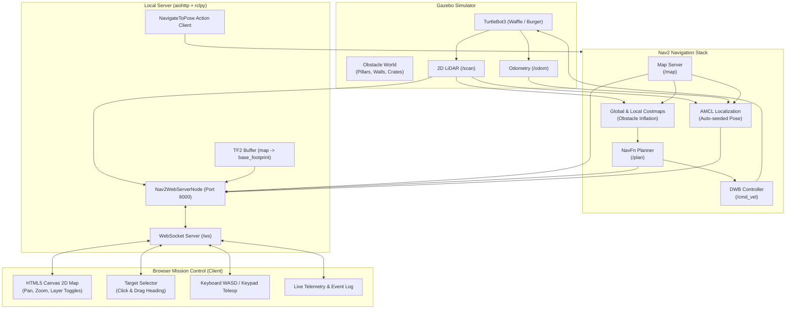

# TurtleBot3 ROS 2 Humble Nav2 Project with Local Web Mission Control

A complete, production-ready **ROS 2 Humble** autonomous navigation project built from scratch with **TurtleBot3**, featuring an obstacle-rich simulation world, a dedicated local server backend, and a modern, high-performance web dashboard.

---

## 🌟 Highlights & Key Features

- **TurtleBot3 in an Obstacle World**: Simulates TurtleBot3 (Waffle or Burger) in Gazebo with walls, cylindrical pillars, and colored obstacle blocks/cylinders.
- **Autonomous Nav2 Stack**: Fully tuned Nav2 configuration featuring AMCL with automatic initial pose seeding, global and local costmaps with obstacle inflation from 2D LiDAR, DWB controller, and NavFn global planner.
- **Local Web Server**: Native Python ROS 2 node powered by `aiohttp` and `rclpy` that serves the web application and provides low-latency bi-directional WebSocket streaming (`ws://localhost:8000/ws`).
- **Interactive Web UI**:
  - **Live Map & Robot Tracking**: Renders the 2D Occupancy Grid map, real-time robot footprint and orientation heading, live LiDAR obstacle hit points, and planned Nav2 paths.
  - **Interactive Target Selection**: Click and drag on the map to select destination coordinates $(X, Y)$ and arrival heading $(\theta)$.
  - **Quick Waypoints**: One-click preset navigation destinations (Center, East Corridor, North Bay, Home Dock).
  - **Manual Teleoperation**: On-screen directional buttons and keyboard navigation (WASD / Arrow keys) with variable speed limiter.
  - **Telemetry HUD & Mission Logs**: Monospace readout of robot position, velocity, remaining distance to goal, and scrolling mission event log.
  - **Smooth Viewport Controls**: Smooth zoom (mouse wheel) and pan (right/middle drag), with "Center on Robot" and "Fit to View" shortcuts.

---

## 🏗️ System Architecture



---

## 📁 Project Directory Structure

```
navigation_llm/
├── run.sh                               # One-click launcher script
├── README.md                            # Complete documentation
└── src/
    └── turtlebot3_nav2_web/             # ROS 2 Python package
        ├── package.xml                  # Package manifest and dependencies
        ├── setup.py                     # Python package build script
        ├── setup.cfg                    # Script installation config
        ├── launch/
        │   ├── simulation.launch.py     # Spawns Gazebo + TurtleBot3 + Obstacles
        │   ├── navigation.launch.py     # Brings up the Nav2 stack
        │   ├── web_server.launch.py     # Runs local Web Server + WebSocket bridge
        │   └── full_system.launch.py    # Master launch file for all 3 components
        ├── config/
        │   ├── nav2_params_waffle.yaml  # Tuned Nav2 parameters for TB3 Waffle
        │   └── nav2_params_burger.yaml  # Tuned Nav2 parameters for TB3 Burger
        ├── maps/
        │   ├── map.yaml                 # Occupancy grid map metadata
        │   └── map.pgm                  # Map raster image
        ├── worlds/
        │   └── obstacle_world.world     # Gazebo world with dynamic obstacle models
        ├── turtlebot3_nav2_web/
        │   ├── __init__.py
        │   └── web_server_node.py       # Local aiohttp HTTP/WebSocket ROS 2 server
        └── web/
            ├── index.html               # Responsive mission control dashboard
            ├── css/
            │   └── style.css            # Dark glassmorphic theme styling
            └── js/
                └── app.js               # Canvas 2D renderer, target picker & teleop
```

---

## 🚀 Quick Start Guide

### 1. Prerequisites
Ensure you are running on an Ubuntu 22.04 environment with ROS 2 Humble installed:
- `ros-humble-desktop`
- `ros-humble-turtlebot3*`
- `ros-humble-navigation2`
- `ros-humble-nav2-bringup`
- Python packages: `aiohttp`, `numpy`, `pillow` (already present)

### 2. Launch Everything in One Command
From the root workspace directory, run:
```bash
cd /home/darms/Documents/gautam_ws/projects/navigation_llm
./run.sh
```

This will automatically:
1. Source ROS 2 Humble and the workspace overlay.
2. Launch Gazebo with TurtleBot3 in the obstacle world.
3. Bring up the Nav2 autonomous navigation stack.
4. Launch the local web server on port `8000`.

### 3. Open the Mission Control Dashboard
Open your web browser and navigate to:
```
http://localhost:8000
```

---

## 🎛️ Launch Options & Customization

The launcher `./run.sh` supports several helpful flags:

| Flag | Description | Default |
| :--- | :--- | :--- |
| `--model <waffle\|burger>` | Select TurtleBot3 model | `waffle` |
| `--headless` | Run Gazebo headless (no 3D GUI window, saves CPU/GPU) | `false` |
| `--port <PORT>` | Custom HTTP port for the web server | `8000` |
| `--web-only` | Launch only the web server node (if sim is already running) | `false` |
| `--build` | Force rebuild before launching | `false` |

#### Examples:
```bash
# Run with TurtleBot3 Burger in headless mode
./run.sh --model burger --headless

# Run on custom port 8080
./run.sh --port 8080

# Launch individual components via ROS 2 CLI
source /opt/ros/humble/setup.bash
source install/setup.bash

# Run full system directly:
ros2 launch turtlebot3_nav2_web full_system.launch.py model:=waffle headless:=false
```

---

## 🖱️ Web UI Operating Instructions

1. **Setting a Navigation Target**:
   - Make sure **"Set Goal"** mode is active (top toolbar).
   - **Click on any navigable area** on the map.
   - **Drag the mouse** in the direction you want the robot to face upon arrival. An arrow dynamically rotates with your cursor.
   - Release the mouse. The $(X, Y, \text{Yaw})$ inputs will update with the chosen coordinate.
   - Click the **"Navigate to Target"** button.
   - Nav2 will compute a collision-free path (visible as a cyan trajectory) and the robot will autonomously drive to the target while avoiding obstacles!

2. **Quick Waypoints**:
   - Click any of the preset buttons in the sidebar:
     - `Center (0, 0)`: Center of the arena.
     - `East Corridor`: Navigates past cylindrical obstacles.
     - `North Bay`: Navigates to the upper corridor.
     - `Home Dock`: Returns the robot to its starting position `(-2.0, -0.5)`.

3. **Manual Driving (Teleoperation)**:
   - Use the **W / A / S / D** keys or arrow keys on your keyboard to drive the robot.
   - Or click and hold the on-screen direction pads (▲, ◀, ▶, ▼).
   - Press **Space** or the red **STOP** key to halt immediately.
   - Adjust the **Linear Speed** slider to fine-tune driving speed.

4. **Emergency Stop & Cancel**:
   - Click the red **"Cancel / Stop"** button at any time to abort the current autonomous navigation goal and command zero velocity.

5. **Re-localization (Initial Pose)**:
   - If AMCL needs manual pose estimation, switch to **"Set Initial Pose"** mode in the toolbar, click and drag on the robot's actual position in the map, and release.

6. **Map Navigation**:
   - **Scroll Wheel**: Smooth zoom in and out.
   - **Right-Click / Middle-Click Drag**: Pan around the arena.
   - **Center on Robot Button**: Snaps the camera directly to the robot's current position.
   - **Fit Map Button**: Centers and fits the entire arena inside the window.

---

## 📡 REST and WebSocket API Reference

The local server exposes both WebSocket and REST endpoints for programmatic control:

### WebSocket (`ws://localhost:8000/ws`)
- **Client to Server Commands**:
  - `{"action": "navigate", "x": 1.5, "y": -0.5, "yaw": 1.57}`: Dispatch navigation goal.
  - `{"action": "cancel"}`: Cancel active navigation goal.
  - `{"action": "initial_pose", "x": -2.0, "y": -0.5, "yaw": 0.0}`: Seed AMCL pose.
  - `{"action": "teleop", "linear": 0.18, "angular": 0.5}`: Drive robot.
  - `{"action": "stop"}`: Emergency halt.
- **Server to Client Streams**:
  - `{"type": "map", "metadata": {...}, "image": "<base64 PNG>"}`: Occupancy grid.
  - `{"type": "robot_state", "pose": {...}, "speed": {...}, "nav_status": "NAVIGATING", "nav_feedback": {...}}`: 15 Hz telemetry.
  - `{"type": "plan", "points": [{"x": ..., "y": ...}]}`: Active planned path.
  - `{"type": "scan", "points": [{"x": ..., "y": ...}]}`: Downsampled LiDAR obstacles.

### HTTP REST Endpoints
- `GET /api/status`: Returns current robot position, velocity, and navigation status.
- `POST /api/navigate`: JSON body `{"x": 1.0, "y": 0.0, "yaw": 0.0}`.
- `POST /api/cancel`: Cancels navigation.
- `POST /api/teleop`: JSON body `{"linear": 0.2, "angular": 0.0}`.
