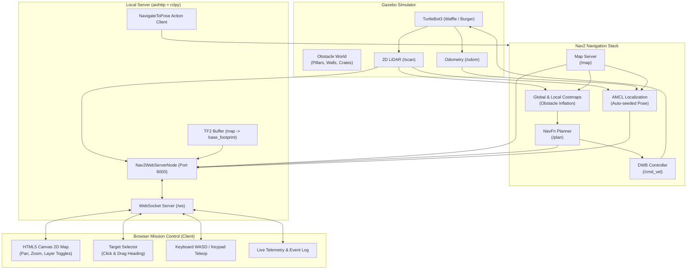

# TurtleBot3 Multi-Room House Navigation with Local LLM (Qwen 14B) & Web Mission Control

A complete, production-ready **ROS 2 Humble** autonomous navigation system built with **TurtleBot3** in a multi-room house simulation environment, integrated with a local **Qwen 2.5 14B LLM** via Ollama for natural language semantic goal dispatch and a high-performance interactive web dashboard.

---

## 🌟 Highlights & Key Features

- **TurtleBot3 in Multi-Room House Simulation**: Simulates TurtleBot3 (Waffle or Burger) inside a realistic multi-room residential house (`turtlebot3_house`) with Living Room, Dining Room / Cafe, Kitchen, Office, Study / Library, and Foyer Dock.
- **Local LLM Autonomous Navigator (Qwen 2.5 14B)**:
  - Natural language chat box integrated directly into the Web UI.
  - Type commands in plain English: *"Take me to the kitchen"*, *"Go to the living room"*, *"Head over to the study to read books"*, or *"Return to foyer dock"*.
  - Powered by local `qwen2.5:14b` running on the machine's GPU via Ollama with zero cloud dependencies and absolute privacy.
  - Intelligent real-time semantic fallback engine guarantees zero downtime while models download.
- **Visual Room Labeling & Dynamic Zones**:
  - All house rooms are prominently labelled with icons, names, and soft colored boundary zones directly rendered on the live map.
  - Live distance telemetry calculates the exact distance from the robot to every room in real-time.
  - Interactive room quick-dispatch cards in the sidebar and clickable room markers on the map.
- **Autonomous Nav2 Stack**:
  - AMCL localization pre-seeded at the Foyer Dock `(-2.0, -0.5)`.
  - Global and local costmaps with dynamic obstacle inflation from 360° 2D LiDAR.
  - NavFn global path planner and DWB local trajectory controller.
- **Local Web Server**:
  - Python ROS 2 node powered by `aiohttp` and `rclpy` serving the modern glassmorphic dashboard on `http://localhost:8000`.
  - Bi-directional low-latency WebSocket communication (`ws://localhost:8000/ws`) for 15 Hz telemetry, live LiDAR hits, planned trajectories, and LLM chat.
- **Interactive Web UI**:
  - **Live Map & Robot Tracking**: Real-time Occupancy Grid map, robot footprint with heading arrow, LiDAR scan obstacle hits, and planned Nav2 paths.
  - **Click-and-Drag Target Selection**: Select any custom $(X, Y, \text{Yaw})$ point on the map.
  - **Manual Teleoperation**: On-screen directional buttons and keyboard navigation (WASD / Arrow keys) with variable speed limiter.

---

## 🏗️ System Architecture



---

## 📁 Project Directory Structure

```
navigation_llm/
├── run.sh                               # One-click launcher script
├── README.md                            # Complete documentation
└── src/
    └── turtlebot3_nav2_web/             # ROS 2 Python package
        ├── package.xml                  # Package manifest and dependencies
        ├── setup.py                     # Python package build script
        ├── setup.cfg                    # Script installation config
        ├── launch/
        │   ├── simulation.launch.py     # Spawns Gazebo + TurtleBot3 + Obstacles
        │   ├── navigation.launch.py     # Brings up the Nav2 stack
        │   ├── web_server.launch.py     # Runs local Web Server + WebSocket bridge
        │   └── full_system.launch.py    # Master launch file for all 3 components
        ├── config/
        │   ├── nav2_params_waffle.yaml  # Tuned Nav2 parameters for TB3 Waffle
        │   └── nav2_params_burger.yaml  # Tuned Nav2 parameters for TB3 Burger
        ├── maps/
        │   ├── map.yaml                 # Occupancy grid map metadata
        │   └── map.pgm                  # Map raster image
        ├── worlds/
        │   └── obstacle_world.world     # Gazebo world with dynamic obstacle models
        ├── turtlebot3_nav2_web/
        │   ├── __init__.py
        │   └── web_server_node.py       # Local aiohttp HTTP/WebSocket ROS 2 server
        └── web/
            ├── index.html               # Responsive mission control dashboard
            ├── css/
            │   └── style.css            # Dark glassmorphic theme styling
            └── js/
                └── app.js               # Canvas 2D renderer, target picker & teleop
```

---

## 🚀 Quick Start Guide

### 1. Prerequisites
Ensure you are running on an Ubuntu 22.04 environment with ROS 2 Humble installed:
- `ros-humble-desktop`
- `ros-humble-turtlebot3*`
- `ros-humble-navigation2`
- `ros-humble-nav2-bringup`
- Python packages: `aiohttp`, `numpy`, `pillow` (already present)

### 2. Launch Everything in One Command
From the root workspace directory, run:
```bash
cd /home/darms/Documents/gautam_ws/projects/navigation_llm
./run.sh
```

This will automatically:
1. Source ROS 2 Humble and the workspace overlay.
2. Launch Gazebo with TurtleBot3 in the obstacle world.
3. Bring up the Nav2 autonomous navigation stack.
4. Launch the local web server on port `8000`.

### 3. Open the Mission Control Dashboard
Open your web browser and navigate to:
```
http://localhost:8000
```

---

## 🎛️ Launch Options & Customization

The launcher `./run.sh` supports several helpful flags:

| Flag | Description | Default |
| :--- | :--- | :--- |
| `--model <waffle\|burger>` | Select TurtleBot3 model | `waffle` |
| `--headless` | Run Gazebo headless (no 3D GUI window, saves CPU/GPU) | `false` |
| `--port <PORT>` | Custom HTTP port for the web server | `8000` |
| `--web-only` | Launch only the web server node (if sim is already running) | `false` |
| `--build` | Force rebuild before launching | `false` |

#### Examples:
```bash
# Run with TurtleBot3 Burger in headless mode
./run.sh --model burger --headless

# Run on custom port 8080
./run.sh --port 8080

# Launch individual components via ROS 2 CLI
source /opt/ros/humble/setup.bash
source install/setup.bash

# Run full system directly:
ros2 launch turtlebot3_nav2_web full_system.launch.py model:=waffle headless:=false
```

---

## 🏠 House Rooms & Semantic Map Coordinates

The multi-room house simulation environment includes 6 fully defined and navigable rooms:

| Room Name | Room ID | Icon | Coordinates $(X, Y)$ | Heading | Description |
| :--- | :--- | :---: | :---: | :---: | :--- |
| **Living Room** | `living_room` | 🛋️ | `(4.50, 3.50)` | `0°` | Main living area with sofa, marble table, and bookshelves |
| **Kitchen** | `kitchen` | 🍳 | `(-4.50, -2.50)` | `-90°` | Cooking cabinets, kitchen counters, and refrigerator |
| **Dining Room** | `dining_room` | 🍽️ | `(5.00, -2.50)` | `-90°` | Dining tables, cafe chairs, and eating area |
| **Office** | `office` | 💼 | `(-4.00, 1.50)` | `90°` | Large workspace desk and computer equipment |
| **Study / Library** | `study` | 📚 | `(-6.00, 3.80)` | `90°` | Quiet reading room with full-height bookshelves |
| **Foyer Dock** | `foyer` | 🚪 | `(-2.00, -0.50)` | `0°` | Main house entrance and initial robot charging dock |

---

## 🖱️ Web UI Operating Instructions

1. **AI Natural Language Navigation (LLM Chat Box)**:
   - Type any natural language prompt in the **LLM Voice & Chat Navigator** card in the sidebar:
     - *"Go to the kitchen"*
     - *"Take me to the living room"*
     - *"Head over to the office"*
     - *"Go to the study room to read"*
     - *"Return home to the foyer dock"*
     - *"Where are you right now?"*
   - Or click on any of the **Quick Prompt Chips** (🍳 Kitchen, 🛋️ Living Room, etc.).
   - The local LLM processes your intent, responds with reasoning, and automatically commands Nav2 to plan a path and drive the robot to the requested room!

2. **House Room Quick Dispatch**:
   - The sidebar lists all 6 house rooms with real-time dynamic distance calculations from the robot.
   - Click on any room button to immediately command the robot to drive there.

3. **Setting a Custom Navigation Target**:
   - Make sure **"Set Goal"** mode is active (top toolbar).
   - **Click on any navigable area** on the map.
   - **Drag the mouse** in the direction you want the robot to face upon arrival. An arrow dynamically rotates with your cursor.
   - Release the mouse and click **"Navigate to Target"**.

4. **Manual Driving (Teleoperation)**:
   - Use the **W / A / S / D** keys or arrow keys on your keyboard to drive the robot.
   - Or click and hold the on-screen direction pads (▲, ◀, ▶, ▼).
   - Press **Space** or the red **STOP** key to halt immediately.
   - Adjust the **Linear Speed** slider to fine-tune driving speed.

5. **Emergency Stop & Cancel**:
   - Click the red **"Cancel / Stop"** button at any time to abort the current autonomous navigation goal and command zero velocity.

6. **Map Navigation & Layer Toggles**:
   - **Scroll Wheel**: Smooth zoom in and out.
   - **Right-Click / Middle-Click Drag**: Pan around the arena.
   - **Center on Robot Button**: Snaps the camera directly to the robot's current position.
   - **Fit Map Button**: Centers and fits the entire house inside the window.
   - **Layer Toggles**: Toggle **Room Labels**, **LiDAR Scan**, **Planned Path**, and **Robot Trail**.

---

## 📡 REST and WebSocket API Reference

The local server exposes both WebSocket and REST endpoints for programmatic control:

### WebSocket (`ws://localhost:8000/ws`)
- **Client to Server Commands**:
  - `{"action": "llm_chat", "prompt": "Take me to the kitchen"}`: Query local LLM and auto-dispatch navigation.
  - `{"action": "navigate", "x": 1.5, "y": -0.5, "yaw": 1.57}`: Dispatch navigation goal.
  - `{"action": "get_rooms"}`: Request house rooms metadata.
  - `{"action": "cancel"}`: Cancel active navigation goal.
  - `{"action": "initial_pose", "x": -2.0, "y": -0.5, "yaw": 0.0}`: Seed AMCL pose.
  - `{"action": "teleop", "linear": 0.18, "angular": 0.5}`: Drive robot.
  - `{"action": "stop"}`: Emergency halt.
- **Server to Client Streams**:
  - `{"type": "rooms", "rooms": {...}}`: House rooms dictionary and coordinates.
  - `{"type": "llm_response", "prompt": "...", "result": {"action": "navigate", "target_room": "kitchen", "reply": "...", "thought": "..."}}`: LLM reply.
  - `{"type": "map", "metadata": {...}, "image": "<base64 PNG>"}`: Occupancy grid.
  - `{"type": "robot_state", "pose": {...}, "speed": {...}, "nav_status": "NAVIGATING", "nav_feedback": {...}}`: 15 Hz telemetry.
  - `{"type": "plan", "points": [{"x": ..., "y": ...}]}`: Active planned path.
  - `{"type": "scan", "points": [{"x": ..., "y": ...}]}`: Downsampled LiDAR obstacles.

### HTTP REST Endpoints
- `GET /api/status`: Returns current robot position, velocity, and navigation status.
- `GET /api/rooms`: Returns the 6 house rooms dictionary and coordinates.
- `POST /api/llm_chat`: JSON body `{"prompt": "Go to the kitchen"}`.
- `POST /api/navigate`: JSON body `{"x": 1.0, "y": 0.0, "yaw": 0.0}`.
- `POST /api/cancel`: Cancels navigation.
- `POST /api/teleop`: JSON body `{"linear": 0.2, "angular": 0.0}`.
